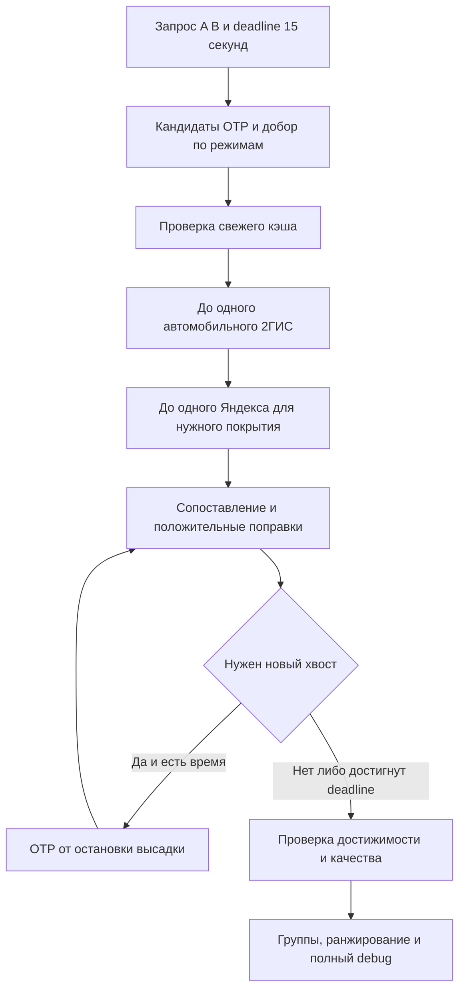

# Дорожные поправки для маршрутов общественного транспорта

Версия 0.3 от 12 ноября 2026 года. Документ целиком одобрен пользователем
12 ноября 2026 года для реализации. Это спецификация целевого алгоритма,
а не утверждение о готовности работающей коррекции.

## 1. Результат и границы

Пользователь задаёт A/B. Система получает кандидатов OTP, оценивает применимые
наземные участки по текущим автомобильным данным и возвращает согласованную
временную цепочку с альтернативами. Это **оценка поездки с дорожной поправкой**,
а не точное предсказание прибытия транспорта и не измерение чистой пробочной задержки.

В первой версии:

- варианты ОТ берём из OTP; допускается дополнительная выборка по отдельным
  разрешённым видам транспорта;
- до одного автомобильного расчёта 2ГИС с альтернативами и одного запроса
  Яндекса на пользовательский поиск; свежий кэш позволяет пропустить вызовы;
- 2ГИС ОТ, собственная генерация маршрутов и GTFS-RT не входят в этап;
- свежесть дорожных данных — **30 минут**, общий deadline поиска — **15 секунд**;
- полная диагностика возвращается всегда, без отдельного debug-флага;
- dummy=true остаётся демо без платных обращений, ошибки real не заменяются демо.

Геометрии автомобилей — наблюдения дорог, а не новые допустимые автобусные пути.

## 2. Данные и зависимости

Дисковый индекс строится другой задачей. Наш алгоритм использует его и держит
необходимый рабочий набор в памяти; не строит индекс и не перечитывает миллионы
stop_times внутри пользовательского поиска.

Контракт чтения индекса должен давать:

- feed_id, версию GTFS и соответствие активному graph_version OTP;
- stop_id, координаты конкретной платформы, имя и parent_station при наличии;
- соседние остановки рейса, stop_sequence, принадлежность линиям/паттернам;
- shape и shape_dist_traveled для межостановочной нарезки;
- исходные времена движения и известные стоянки;
- service/calendar, frequency-окна, headway_secs и exact_times.

Нужна именно база **активного графа**, а не автоматически latest-выгрузка.
Её сохранение — зависимость работающего графа, а не архив всей истории GTFS.
При несовместимости/отсутствии базы поправка соответствующего участка не
вычисляется; маршрут получает признаки неполноты. Ошибки календаря и модельные
исходные данные остаются видимыми после дорожной поправки.

### Вспомогательный граф остановок

- Узел: `(feed_id, stop_id)`, без объединения одинаковых названий.
- Ребро: `(feed_id, from_stop_id, to_stop_id)` для соседних остановок.
- Геометрия, её отпечаток, длина и обслуживающие линии — атрибуты ребра.
- Несовместимые геометрии одной пары не смешиваются; помечаются ambiguous.
  Обязательный мультиграф заранее не вводится.
- Конкретное прохождение ребра в поездке идентифицируется отдельно через
  trip/service day и stop_sequence. Повторный проезд кольца не равен
  повторному вычислению одной поправки.

В текущем GTFS найдено 8 811 остановок и 11 230 направленных рёбер. Замер:
топология 9,20 МиБ; вместе со всеми общими компактными геометриями 35,69 МиБ;
RSS отдельного процесса 57,66 МиБ, пик 67,74 МиБ. Сам граф помещается в память;
кэш, пространственный индекс, конкурентные буферы и обновление версий требуют
отдельного бюджета. TTL не заменяет ограничения объёма кэша.

## 3. Источники автомобильных оценок

**2ГИС:** driving, fastest, jam, detailed, альтернативы одного A/B. utc не
задаём. Альтернативы одного набора точек дополнительно не оплачиваются;
пакет независимых пар тарифицируется по каждой паре и не считается одним расчётом.

**Яндекс:** driving, без будущего departure_time; принимаем как текущий снимок
только ответ с traffic_type=realtime. До 50 точек, порядок не оптимизируется
через optimize=true. Альтернативы с 3+ waypoints на нашем ключе не проверены;
на ближайшем этапе разнообразие автомобильных путей даёт 2ГИС.

Внутренний формат RoadObservation содержит провайдера, время получения и
истечения свежести, направленную геометрию, длину, duration и индексы части ответа.
Яндекс duration относится к целому step; 2ГИС — к целому outcoming_path,
а не каждому элементу его geometry. Последний манёвр 2ГИС может не иметь пути.

Нужны все полученные альтернативы и сегментные времена, а не только общая
длительность и одна склеенная линия. Полученные и фактически применённые
источники обозначаются раздельно.

Автомобильная оценка включает особенности движения машины, а не только пробки.
Второй вызов «без пробок» для вычитания не предусматривается.

## 4. Порядок одного поиска

1. Зафиксировать исходный запрос, активные версии данных и monotonic deadline.
2. Получить общий набор OTP. При наличии времени дополнить его запросами
   по отдельным разрешённым видам транспорта, сохраняя ограничения пользователя.
3. Извлечь применимые межостановочные части всех кандидатов и проверить кэш.
4. При нехватке данных выполнить не более одного автомобильного расчёта 2ГИС
   с альтернативами. Сохранить дорожные наблюдения и пересчитать покрытие.
5. Составить цепочку Яндекса для ещё нужных частей путей OTP. При свободном
   бюджете точек добавить расширение покрытия. Не делать второй платный вызов
   для исправления неудобной цепочки или восстановления хвоста.
6. Сопоставить наблюдения, выбрать источники и вычислить положительные поправки.
7. Пересчитать поездки, переходы и ожидания в порядке движения. При необходимости
   восстановить хвост; новые сегменты хвоста проходят тот же конвейер.
8. До deadline закончить доступную обработку, классифицировать качество,
   ранжировать и сформировать полный диагностический ответ.

15 секунд включают весь поиск, ожидание API и формирование ответа. Каждому
вызову передаётся оставшийся бюджет; новые задачи после deadline не запускаются.
Автоматические платные повторы и дополнительные вызовы сверх бюджета запрещены.



## 5. Цепочка точек Яндекса и расширение покрытия

Приоритет: все текущие кандидаты OTP → BFS глубины 1 → глубины 2.
Внутри слоя выше рёбра, общие нескольким кандидатам, затем обслуживаемые большим
числом разных линий, затем близость/стоимость присоединения. Это интенсивность
обслуживания по GTFS, а не пассажиропоток или история спроса пользователей.

Допускаются опорные остановки: развилки и границы общих участков. Каждую
остановку передавать не требуется, цель — охватить все варианты OTP в пределах
50 точек. Фактическую геометрию ответа всё равно проверяем. Набор опорных точек
не гарантирует нужного автомобильного пути между ними.

Целевые переходы и соединительные переезды различаются. В цепочке
`1→2→3→9→2→4→9` возврат `9→2` соединяет ветви; он не считается обратным
автобусным ребром автоматически. Повторная точка расходует место из лимита.
Полезные наблюдения соединителей можно переиспользовать после обычной проверки.

Нет согласованного жёсткого лимита километров: длинная цепочка из 49 переходов
сама по себе нормальна. В debug показываются длина/время обхода, объезды и
полезное покрытие. Не нужно заполнять все 50 мест любой ценой.

## 6. Сопоставление геометрии и применимость

Сопоставляется протяжённая часть пути в одном направлении, с учётом порядка
прохода точек, а не единичное пересечение линий. Проверяются параллельные дороги,
развязки, контрполосы, неоднозначные геометрии и ограничения машины.

Техническое предложение исполнителя для первой реализации: поиск близких
сонаправленных фрагментов с монотонной проекцией вдоль пути. Начальные
настраиваемые пороги для проверки на фикстурах — боковое расстояние 20 м и
разница направлений 30°. Они не являются доказанной точностью: при нескольких
равноправдоподобных дорогах совпадение считается ambiguous и не применяется.
Пороговые значения — параметры реализации, проверяемые на примерах.

Официальный перечень выделенок Петербурга — начальный источник положительных
сведений, не готовый геослой и не доказательство отсутствия полосы вне списка.
Нужна привязка к части направленного пути, с источником и датой версии.

- Подтверждённая выделенка: исходная оценка ОТ без автомобильной поправки.
- Обособленный трамвай: автомобильная поправка не применяется.
- Подтверждённый общий поток: применяется общая модель.
- Неизвестный статус: поправка разрешена с предупреждением.
- Метро и железнодорожные участки автомобильными пробками не корректируются.

## 7. Выбор источника и кэш

Сначала качество геометрического совпадения, затем свежесть. Противоречащие
оценки не суммируются и не перемножаются. Конфликт сохраняется в debug.
При полном равенстве технический порядок должен быть стабильным и указанным
в диагностике; это не заявление, что один провайдер всегда точнее другого.

Наблюдения хранятся отдельно от автобусного расписания. Ключ включает
направленную геометрию/её идентичность; привязка к stop-edge хранится отдельно.
Отношение car_time/bus_time не является универсальным коэффициентом улицы.

Свежесть — 1800 секунд от получения; чтение не продлевает срок. Объединяются
одновременные обращения за теми же данными, задаётся лимит памяти кэша.
Обновление GTFS требует пересчёта временной базы и проверки геометрической
привязки, но не обязательно уничтожает ещё свежую совместимую дорожную оценку.

Снимок применяется ко всей поездке. Возраст данных сейчас и ожидаемый возраст
при будущем въезде на участок показываются раздельно; это не прогноз будущих
пробок. Просроченные данные не выдаются за свежие, отсутствие данных — за
свободную дорогу.

## 8. Формула поправки

Для ребра e: L — длина, T — исходное время движения. Известные стоянки
отделяются. Покрытие делится на непересекающиеся фрагменты j, на каждом
используется одно выбранное наблюдение.

```text
T_j = T × l_j / L
C_j = автомобильное время сопоставленной части шага
added_j = max(0, C_j - T_j)
corrected_moving_time_e = T + sum(added_j)
```

При частичном совпадении шага C_j распределяется пропорционально длине.
Оба распределения являются приближениями и обозначаются в debug.

Согласованный пример: 8 минут движения, покрыта половина пути, автомобильное
время этой половины 6 минут. Её исходная база — 4 минуты, добавляем 2 минуты;
получается 10 минут движения, непокрытая половина не изменяется.

Стоянка учитывается один раз на промежуточной остановке, где пассажир остаётся
в машине; не добавляется до посадки или после высадки. Поправка считается от
исходной базы, а не от уже исправленного времени предыдущей итерации.
При нулевой длине/отсутствии базы/неоднозначности поправка пропускается с причиной.

## 9. Временная цепочка и восстановление хвоста

Первое отправление остаётся по данным OTP. Для frequency exact_times=0 это
модель, не отправление известного физического автобуса. Свою модель половины
или полного интервала не вводим, модель ожидания оставляем OTP.

После изменения прибытия:

- **Точное расписание:** если следующая посадка достижима с переходом и
  требованиями OTP/GTFS, её отправление сохраняется; ожидание может сократиться.
  Если посадка недостижима, нужен новый хвост.
- **Интервальное обслуживание:** после любой задержки прибытия нужен новый
  хвост, даже если прежняя модельная посадка достижима.

Хвост запрашивается от остановки высадки исправленной поездки с новым временем
готовности. Весь прежний остаток — переход, ожидание и поездки — заменяется.
OTP может выбрать другую платформу. Префикс до высадки сохраняется неизменным.

Передаются разрешённые виды транспорта, поддерживаемые ограничения пользователя
и оставшийся бюджет пересадок с учётом границы префикса/хвоста. Свой запас
сверх OTP/GTFS не добавляется; один минимум не учитывается дважды.

После успешного восстановления эта граница считается обработанной. Тот же
запрос из-за той же задержки повторно не запускается. Новые сегменты хвоста
получают поправки от собственной исходной базы; их новые задержки могут
потребовать восстановления следующих границ. Одинаковые входы без прогресса
останавливают цикл, причина сохраняется.

### Исход при deadline или ошибке восстановления

1. Старая точная/модельная посадка уже недостижима, восстановление не завершено:
   кандидат исключается из обычной выдачи, исходный вариант и причина — в debug.
2. Интервальная посадка по старой модели ещё достижима, но обязательный
   перезапрос не завершился: старый хвост возвращается **непроверенным**,
   с предупреждением. Он относится к группе неполной оценки независимо
   от процента дорожного покрытия. При сшивке нельзя оставлять отрицательное
   ожидание или нарушенную связность. Это согласованное исключение при deadline.
3. Новый хвост выходит на непокрытые дороги, а платный бюджет исчерпан:
   исходные времена этих частей сохраняются; маршрут возвращается частичным.

## 10. Покрытие, группы и ранжирование

Применимая база — расстояние всех наземных частей, для которых допустима
автомобильная поправка. Исключаются только подтверждённые неприменимые части
выделенок/обособленного полотна и неподходящие виды транспорта. Неизвестный
статус, отсутствие совпадения или временной базы не уменьшают знаменатель.

В числитель достаточной оценки входят непересекающиеся части с валидной
свежей дорожной оценкой, совпадением направления и доступной временной базой.
Нулевое added не делает участок непокрытым: машина может быть быстрее автобуса.
Отдельно диагностируется дорожное покрытие, для которого база поправки недоступна.

- Не менее **80% по расстоянию** и нет незавершённого обязательного
  восстановления — группа достаточной оценки.
- Меньше 80% либо возвращён непроверенный старый интервальный хвост — неполная.
- При нулевой применимой длине: not_applicable, ratio=null, не выдуманные 100%.
  Такой маршрут не требует дорожной коррекции и ранжируется с достаточной группой.
- Недостижимая невосстановленная пересадка — исключение, не обычный partial.

Общий max_results заполняется сначала достаточными, затем неполными на
оставшиеся места. Внутри группы: раньше прибытие → меньше пересадок → меньше
ходьбы. Источники и основание группы сохраняются. При отсутствии допустимых
кандидатов routes=[] с причинами в диагностике, без подмены неработающим маршрутом.

## 11. Диагностика

Полная структурированная диагностика возвращается всегда, в том числе для
исключённых вариантов. Повторные геометрии и наблюдения желательно передавать
по ID, а не многократно копировать. Ключи API, заголовки авторизации и URL с
секретами не включаются.

Нужны trace_id, версии графа/базы/алгоритма, исходный OTP ID и ранг,
исходное/новое время, события восстановления, покрытие и непокрытые интервалы,
возраст наблюдений и горизонт въезда, выбранные/отклонённые источники,
геометрические причины, тип полотна, интерполяция, ожидания и признаки
интервального обслуживания, ошибки/пропуски вызовов и оплачиваемые расчёты.

OpenAPI уже расширен черновыми необязательными debug-блоками. Пока конвейер
не реализован, значения null означают «не оценено», а не отсутствие пробок.

## 12. Проверки реализации

- Целое/частичное совпадение, направление, параллельная дорога, отсутствие
  shape, нулевая длина, неоднозначность и отсутствие временной базы.
- Пропорциональное распределение и отсутствие двойной поправки/двойной стоянки.
- Стоянки, ожидание и последовательные времена; точное и интервальное обслуживание.
- Успешный новый хвост, непокрытые дороги нового хвоста, повторные входы без
  прогресса и соблюдение оставшегося лимита пересадок.
- Deadline: исключение недостижимой посадки против допустимого непроверенного
  frequency-fallback с достижимой прежней моделью.
- TTL 30 минут без продления чтениями, общий кэш, объединение одинаковых
  обращений, лимит памяти и несовместимые версии.
- Покрытие при added=0, граница 80%, not_applicable, обе группы и max_results.
- Один Яндекс + один автомобильный 2ГИС, отсутствие платных повторов и
  корректный результат при ошибке/квоте. Офлайн-тесты не расходуют ключи.
- Полная диагностика без секретов, временные бюджеты и объём ответа.

До реализации подтверждены 409 офлайн-тестов существующего проекта и расширенного
контракта; это не тесты ещё не реализованного алгоритма и не оценка точности ETA.

## 13. Исследовательские материалы

- [План интеграции](../../../backend/PLAN.md).
- [OpenAPI](../../../openapi.yaml).
- [Замер памяти](../../../research/traffic-correction/stop-graph-memory.md).
- [Проверка GTFS и хранения исходников активного графа](../../../research/traffic-correction/gtfs-stop-graph-review.json).
- [Восстановление хвоста и полный повторный поиск](../../../research/traffic-correction/otp-transfer-replanning.md).
- [Почему альтернатива отсутствует в обычной выдаче](../../../research/traffic-correction/otp-alternative-filter-review.md).
- [Все этапы двух сравниваемых маршрутов](../../../research/traffic-correction/otp-route-stage-comparison.md).
- [Первый запрос Яндекса на 50 остановок](../../../research/traffic-correction/yandex-50-stops/request.http), [ответ](../../../research/traffic-correction/yandex-50-stops/probe.json), [карта](../../../research/traffic-correction/yandex-50-stops/probe-map.html).
- [OTP → 2ГИС → Яндекс, Пионерская — Родео Драйв](../../../research/traffic-correction/pionerskaya-rodeo-drive/README.md), [карта](../../../research/traffic-correction/pionerskaya-rodeo-drive/map.html).

Два отдельно разрешённых живых опыта использовали суммарно два Яндекс-запроса
и один автомобильный 2ГИС; дополнительных платных вызовов не выполнялось.
Факт traffic_type=realtime подтверждён; свободный поток и чистая величина
пробочной задержки этими ответами не измерены. Выбор 48 дополнительных точек
в опыте Родео Драйв использовал fallback около прямого A/B, не обход всего
трамвайного кандидата; это ограничение опыта, не реализация планируемого обхода.

Встроенная дедупликация OTP уже работает. Будущий дополнительный набор по видам
транспорта нужен потому, что некоторые альтернативы отсутствуют ещё до postfilters,
а не потому, что фронт скрывает их.

Источники ограничений API и модели данных:

- [Яндекс: параметры запроса](https://yandex.ru/maps-api/docs/router-api/request.html) и [ответ](https://yandex.ru/maps-api/docs/router-api/response.html).
- [2ГИС: возможности, ограничения и тарификация](https://docs.2gis.com/api/navigation/routing/overview).
- [GTFS: интервальное обслуживание](https://gtfs.org/documentation/schedule/reference/#frequenciestxt).
- [Перечень выделенок Петербурга](https://www.gov.spb.ru/gov/otrasl/c_transport/vydelennye-polosy-dlya-obshestvennogo-transporta/).

## 14. Реестр договорённостей

| ID | Решение |
| --- | --- |
| D01 | OTP — источник кандидатов ОТ. Новые маршруты вне кандидатов OTP отложены. |
| D02 | До одного запроса Яндекса и одного автомобильного расчёта 2ГИС на поиск; кэш может уменьшить расход до нуля. |
| D03 | 2ГИС запрашивается для автомобиля с альтернативами и текущими пробками. Запрос ОТ 2ГИС остаётся отложенным черновиком. |
| D04 | Яндекс собирает дорожные оценки; до 50 точек в запросе. Приоритет — текущие кандидаты, затем полезное расширение покрытия. |
| D05 | Свежесть дорожных данных — 30 минут (1800 секунд) от получения, без продления чтениями. Это последняя договорённость, заменяет прежние 15 минут. |
| D06 | Дорожные наблюдения хранятся отдельно от расписания автобуса. Автомобильное время/геометрия — наблюдение, коэффициент вычисляется относительно базы конкретной поездки; детали ключей и хранения задаются контрактом. |
| D07 | Поправка применяется только когда автомобильная оценка медленнее исходной оценки ОТ на сопоставимом участке. Стоянки сохраняются отдельно по D25, формула — D31. |
| D08 | Отправление первого транспорта пока по расписанию. Возможный GTFS-RT — будущий источник, не зависимость MVP. |
| D09 | Для восстановления пересадок допустимы дополнительные запросы к OTP; они входят в общий deadline 15 секунд и правила D32/D33/D37. |
| D10 | Рабочее направление обсуждения — граф остановок с ключом по ID; конкретная схема и обработка неоднозначностей ещё согласуются. |
| D11 | Для выделенок используем официальный перечень Петербурга; привязку к направленным дорогам ещё нужно подготовить. |
| D12 | Debug и признаки качества — существенная часть контракта; отсутствие наблюдения не означает отсутствие пробки. |
| D13 | dummy=true сохраняет прежний смысл, не расходует платную квоту. Нельзя подменять ошибку real синтетикой. |
| D14 | Во время разработки платные эксперименты имеют отдельный явный бюджет. Бюджет каждого живого эксперимента фиксируется отдельно в исследовательских материалах. |
| D15 | Для интервального GTFS оставляем модель ожидания OTP, явно обозначая её модельной. Не подменяем на половину/полный интервал самостоятельно. |
| D16 | Варианты хвоста и полного повторного поиска смоделированы; пользователь выбрал восстановление хвоста. Начальная часть кандидата фиксируется, затем OTP строит остаток от новой точки/времени. Полный поиск остаётся только исследованием. |
| D17 | Общий deadline пользовательского поиска — 15 секунд. После его достижения новые дополнительные OTP не запускаются; конкретная отмена/сбор уже выполняющихся задач и резерв времени на сериализацию — детали реализации. |
| D18 | На подтверждённой выделенке исходная оценка ОТ сохраняется. При неизвестном статусе автомобильная поправка допускается с явным предупреждением. |
| D19 | Выбор дорожной оценки: сначала качество геометрического совпадения, затем свежесть. Конфликт сохраняется в debug; оценки не складываются. Разрешение точного равенства ещё открыто. |
| D20 | Сначала обходятся участки всех кандидатов OTP, затем при наличии бюджета разрешён свободный обход. Не требуется искусственно начинать сбор прямым A → B, если это не покрывает нужные участки. Что делать, если все кандидаты не помещаются в 50 точек, ещё обсуждается. |
| D22 | Дисковый индекс строится другой задачей. В текущем алгоритме он является зависимостью; отдельную реализацию индекса не дублируем. |
| D23 | При нехватке 50 точек разрешены опорные остановки — развилки и границы общих участков — ради охвата всех вариантов OTP. Совпадение фактической геометрии всё равно проверяется. |
| D24 | Время частично совпавшего дорожного шага разрешено распределять пропорционально длине, с явным признаком приближения/интерполяции. |
| D25 | Известные стоянки из GTFS сохраняются отдельно; дорожная поправка применяется к движению между остановками. Неизвестную стоянку не выдумываем. |
| D26 | Текущий дорожный снимок применяется ко всей поездке, с явным горизонтом оценки и возрастом наблюдения к моменту проезда. TTL не выдаётся за гарантию будущего трафика. |
| D27 | Если новый хвост вышел на дороги без свежих оценок после исчерпания бюджета, маршрут возвращается с исходными временами непокрытых частей и признаками частичной коррекции. |
| D28 | Варианты с достаточной дорожной оценкой и варианты с неполной оценкой разделяются. Порог достаточности — 80% по расстоянию (D34); непокрытая дорога не считается свободной от пробок. |
| D29 | Сбор: рёбра текущих кандидатов → BFS глубины 1 → глубины 2; внутри слоя выше общие рёбра нескольких вариантов и рёбра с большим числом разных линий, затем близость. |
| D30 | Пока вся диагностическая информация отдаётся всегда; подробности не прячутся за debug=true. До реализации поля остаются null, а не выдуманными данными. |
| D31 | На покрытой части ребра добавляем только положительную разницу автомобильного и исходного времени движения. Непокрытую часть сохраняем; распределение исходного времени по длине — явно обозначенное приближение. |
| D32 | Последний выбор пользователя: для интервального следующего транспорта заново запрашиваем хвост после любой задержки прибытия на пересадку, даже если прежняя модельная посадка ещё достижима. Это заменяет прежний выбор о пересчёте только при недостижимости. Для точного расписания достижимый рейс сохраняется. Все вызовы укладываются в общий deadline 15 секунд. |
| D33 | Хвост строится от остановки высадки после исправленной поездки. Весь прежний остаток — переход, ожидание, поездки — заменяется; OTP может выбрать другую платформу. |
| D34 | Достаточная дорожная оценка — покрыто не менее 80% расстояния применимых наземных участков. Непокрытая часть явно отмечается; метро и подтверждённые выделенки исключаются из применимой базы. |
| D35 | Трамвай различается по полотну: обособленное не корректируем автомобильным временем; движение в общем потоке корректируем по общей модели. Неизвестный статус допускается с предупреждением. |
| D36 | Дополнительная выборка OTP по отдельным разрешённым видам транспорта допускается до дорожных поправок, в общем бюджете 15 секунд. Это расширение кандидатов OTP, не собственный генератор маршрутов. |
| D37 | Собственный дополнительный запас на пересадку не добавляем. Требования OTP/GTFS и физический переход сохраняем, не учитывая один и тот же минимум дважды. |
| D38 | Недостижимая невосстановленная пересадка исключается из обычной выдачи; исходный вариант и причина сохраняются в debug. Для достижимой старой frequency-модели действует D40. |
| D39 | Общий max_results заполняется сначала вариантами с достаточным покрытием; неполные попадают только на оставшиеся места. Внутри групп — раньше прибытие, затем меньше пересадок и ходьбы. |
| D40 | Если обязательный новый интервальный хвост не завершился до deadline, но старая модельная посадка ещё достижима, возвращаем старый хвост как непроверенный с предупреждением и в группе неполной оценки. |

## Final verification checkpoint

After the lane-data, exact recovery-duplicate and cache-order fixes, the full backend suite passed **509 tests in 10.60 seconds**, with one warning: **177 above the original 332-test baseline**. The OpenAPI snapshot matches and `git diff --check` is clean. Previously verified unchanged components contribute 103 other CI Python tests and 14 frontend tests, for **626 automated tests total**; the frontend build succeeded. The 35 independent lane-acceptance cases, 8 builder cases and 41-case acceptance/recovery subset are overlapping views within that backend total, not additional tests to sum.
